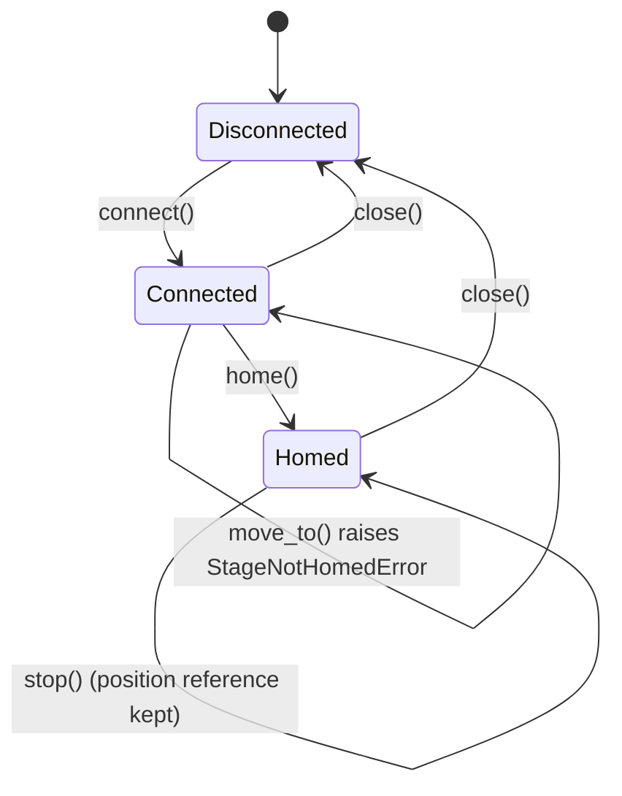
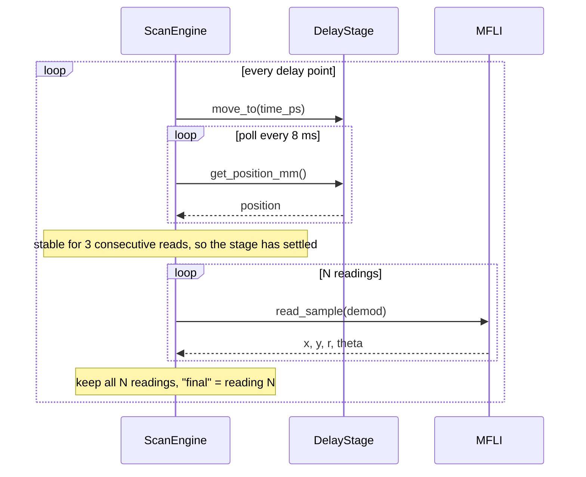
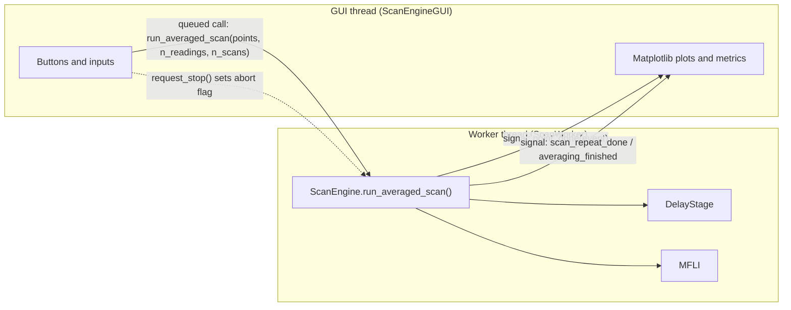

# OKE Pump–Probe Acquisition Platform

**A Python control and acquisition system for an optical Kerr effect (OKE) pump–probe experiment: a motorised Thorlabs delay stage, a Zurich Instruments MFLI lock-in amplifier, and a PyQt5 GUI that ties them together.**

Built during my research internship at the Division of Electronic and Photonic Materials (EFM/IFM), Linköping University.


The project was developed in three steps, and this README follows the same order:

| Step | Goal | Main files |
|------|------|------------|
| **1** | Talk to the motorised delay stage from Python, addressing it in *picoseconds* instead of millimetres | `delay_class2.py` (first prototype) → `delay_stage.py` |
| **2** | Integrate the lock-in amplifier and automate *move → settle → measure → average* | `lockin.py`, `scan_engine.py` |
| **3** | Wrap everything in a GUI for live, repeatable, saved acquisitions | `Scan_Engine_Gui.py` |

---

## Table of contents

1. [Scientific context](#1-scientific-context)
2. [Repository layout](#2-repository-layout)
3. [Installation](#3-installation)
4. [Step 1 — Talking to the delay stage](#4-step-1--talking-to-the-delay-stage)
5. [Step 2 — Integrating the lock-in amplifier](#5-step-2--integrating-the-lock-in-amplifier)
6. [Step 3 — The acquisition GUI](#6-step-3--the-acquisition-gui)
7. [A typical measurement session](#7-a-typical-measurement-session)
8. [Problems solved along the way](#8-problems-solved-along-the-way)
9. [Validation status and known limitations](#9-validation-status-and-known-limitations)
10. [Possible next steps](#10-possible-next-steps)
11. [Author and acknowledgements](#11-author-and-acknowledgements)

---

## 1. Scientific context

In an OKE pump–probe experiment, an intense **pump** pulse briefly changes the optical properties of a sample (it induces a transient birefringence). A weaker **probe** pulse, sent through the sample after a controllable **delay** τ, reads out that change. Recording the probe signal as a function of τ gives the ultrafast response of the material.

Two things have to be controlled very precisely for this to work:

1. **The delay τ.** It is set by changing the length of the optical path of one beam with a motorised retro-reflector. Light travels 0.29979 mm per picosecond, so a few femtoseconds correspond to a few micrometres of stage travel.
2. **The detection.** The pump is chopped (here at 5 kHz) and the probe signal is recovered with a lock-in amplifier locked to the chopper, which pulls a tiny signal out of a large noise background.

The software in this repository automates both, so that a delay scan becomes a repeatable, logged, averaged measurement instead of a manual one.

**Optical setup this software was written for** (adapt to your own rig): heterodyne-detected OKE with a 1030 nm / ~170 fs laser, a 5 kHz chopped pump, a motorised probe delay line, a quarter-wave plate, a Wollaston prism, a balanced photodiode and a lock-in amplifier.

---

## 2. Repository layout

The imports in the code (`from oke_system.hardware.delay_stage import DelayStage`) expect the following structure. The GUI also walks up from its own location to find the `oke_system/` folder, so it keeps working if you move or rename the parent folder.

```
.
├── oke_system/
│   ├── hardware/
│   │   ├── delay_stage.py        # Step 1 — DelayStage class (production version)
│   │   └── lockin.py             # Step 2 — MFLI class (Zurich Instruments)
│   └── acquisition/
│       └── scan_engine.py        # Step 2 — ScanEngine + ASCII writers
├── gui/
│   └── Scan_Engine_Gui.py        # Step 3 — PyQt5 application
├── legacy/
│   └── delay_class2.py           # Step 1 — first working prototype (kept for history)
└── docs/
    ├── figures/                  # figures used in this README
    └── make_figures.py           # script that regenerates the schematic figures
```

---

## 3. Installation

```bash
conda create -n oke python=3.10
conda activate oke
pip install numpy matplotlib PyQt5 pylablib zhinst
# only needed for the legacy prototype's older laser-delay classes:
pip install pyvisa pyserial
```

You also need:

* **Thorlabs Kinesis** installed, so that the USB drivers for the rack controller are present.
* **LabOne** (Zurich Instruments) with its Data Server running on the lab PC.

Then run the GUI:

```bash
python gui/Scan_Engine_Gui.py
```

---

## 4. Step 1 — Talking to the delay stage

### 4.1 First prototype: `delay_class2.py`

The first goal was simple: *make the stage move to a requested delay from a Python script.* The prototype wraps pylablib's `KinesisMotor` in a small class, `thorlabs_delay_stage`:

```python
self.stage = KinesisMotor(self.SERIAL, scale=(20000, 134217.73, 13.744), is_rack_system=True)
```

Three decisions made here carried through to the final version:

* **The stage is addressed by time, not position.** `move_to(time_point_ps)` converts picoseconds to millimetres internally.
* **Positions are clamped** to the physical travel (0 – 220 mm for the DDS220/M).
* **The scale tuple `(20000, 134217.73, 13.744)`** converts Kinesis's internal steps to mm, mm/s and mm/s². It had to be set by hand (see [section 8](#8-problems-solved-along-the-way)).

The file also contains `pink_laser_delay` (GPIB generator) and `disco_laser_delay` (serial delay generator). These are electronic delay options that follow the same interface (`move_to`, `check_time`, `check_times`) and are kept only for reference.

### 4.2 Converting delay to position

The probe beam makes a **double pass** over the retro-reflector, so moving the stage by *d* changes the path length by *2d*:

$$
\text{mm} = (t_0 - t)\cdot \frac{c}{2}, \qquad \frac{c}{2} = 0.149895\ \text{mm/ps}
$$

`t₀` is the *time-zero* reference: the delay (in ps) that corresponds to the stage being at mm = 0. In the final code, `t₀` is not a magic number. It is derived from a physical position, so it can never silently go stale:

```python
T0_POSITION_MM = MAX_MM                                   # 220 mm: far end of the travel

@classmethod
def t0_ps_for_position_mm(cls, position_mm, mm_per_ps=None):
    factor = cls.MM_PER_PS if mm_per_ps is None else mm_per_ps
    return position_mm / factor                           # = 1467.694 ps for 220 mm
```


*With the default `t₀`, delay 0 ps sits at 220 mm and delays up to ≈1467.7 ps are reachable. After you find the true overlap position on the rig, `define_home_here()` re-defines `t₀` so that negative delays become reachable too.*

### 4.3 The production class: `DelayStage` (`delay_stage.py`)

The prototype worked, but it moved the stage without checking anything. The final class adds the safety and bookkeeping that a long unattended scan needs.

#### Key methods

| Method | What it does |
|---|---|
| `connect()` | Opens the Kinesis connection by serial number (`is_rack_system=True` for the DDS220/M). Does **not** home. |
| `home(timeout)` | Homes the stage with `force=True` and waits for completion. Required before any move. |
| `move_to(time_ps)` | Converts ps → mm, clamps to `[MIN_MM, MAX_MM]`, moves, waits, and **returns the actual position read back from the controller**. |
| `jog(delta_ps, current_time_ps)` | Relative move built on `move_to()`. |
| `get_position_mm()` / `mm_to_ps()` | Read back the position and convert it to a delay. |
| `define_home_here()` | Re-defines `t₀` as the current physical position without moving. Used after locating time-zero on the live signal. |
| `reachable_window_ps()` | Returns `(t_min, t_max)` reachable for the current `t₀`. |
| `check_time()` / `check_times()` | Check whether delay points map to reachable positions. Available for pre-scan validation; as a safety net, `move_to()` always clamps to the travel limits. |
| `set_velocity_params()` / `get_velocity_params()` | Set or read velocity and acceleration, clamped to the rated limits. |
| `get_status()` | Connected / homed / moving / position / raw status bits, safe to call at any time (used by the GUI status poll). |
| `stop()` | Emergency stop: halts motion immediately without clearing the homed flag. |

#### Stage lifecycle

The class enforces the order *connect → home → move* in code, not only by convention:



#### Design decisions

* **Explicit constructor arguments, no hidden defaults.** The stage was swapped twice during the internship (DDS220/M → LTS150 → DDS220/M), and silently reusing a stale serial number or scale would have caused confusing failures.
* **Custom exceptions** (`StageNotConnectedError`, `StageNotHomedError`) give readable errors in the GUI log.
* **`move_to()` returns the *measured* position**, not the commanded one, so a stage that silently fails to move can be detected.
* **A retry wrapper for a communication bug.** The Thorlabs protocol can desynchronise when a status request crosses a "move completed" message. `_with_retry()` runs the call under a `threading.Lock`, flushes the buffer, and retries, but **only** for that specific error. Any other exception (for example "Access is denied" because another program holds the COM port) fails immediately instead of being hidden behind retries.

```python
except ThorlabsError as e:
    if "unexpected command received" not in str(e):
        raise                       # a real hardware problem: fail fast
    self._stage.flush_comm()        # drain the stray message, then retry
```

#### Minimal example

```python
from oke_system.hardware.delay_stage import DelayStage

stage = DelayStage.for_t0_position_mm("103537224", is_rack_system=True)
stage.connect()
stage.home()                 # mandatory before any move
stage.move_to(20.0)          # go to +20 ps
print(stage.get_position_mm(), "mm")
stage.close()
```

---

## 5. Step 2 — Integrating the lock-in amplifier

### 5.1 The lock-in wrapper: `MFLI` (`lockin.py`)

`MFLI` is a thin wrapper around Zurich Instruments' `zhinst.core.ziDAQServer`. Like `DelayStage`, it takes its connection parameters explicitly, because wrong interface or device settings were the main source of early connection failures.

| Method | What it does |
|---|---|
| `connect()` | Opens the Data Server session (port 8004, API level 6) and attaches to the device. Reads the device timebase for timestamp conversion. |
| `configure_demod(demod_index, rate_hz)` | Enables a demodulator and requests a sample rate. |
| `get_actual_rate()` | Reads back the rate actually applied. The MFLI **quantises** requested rates (a request of 1000 Sa/s gave about 837 Sa/s), so never assume the requested value. |
| `read_sample(demod_index)` | Single `getSample()` returning `x`, `y`, `r`, `theta_deg`. R and θ are computed here from X and Y. |
| `poll(duration_s, demod_index)` | Streaming acquisition with `daq.poll(..., flat=True)`. Validated to give contiguous timestamps with no gaps over multi-minute runs. |
| `load_labone_config(json_path, ...)` | Applies a LabOne settings export to the device (see below). |
| `get_input_utilization()` | Reads the input range utilisation and flags a signal within 10 % of full scale. |
| `get_reference_status()` | Chopper reference lock status and frequency. |

**Connection pitfall.** If the LabOne desktop application already owns the PCIe link, a second client must connect through the *other* interface. The GUI therefore connects with `interface="1GbE"`.

#### Loading a LabOne configuration

Instead of re-entering demodulator, filter and input settings by hand, the settings saved from the LabOne UI (`File → Save Settings`) can be applied from Python. The loader walks the JSON tree, converts LabOne's `ch0`-style keys to zhinst node paths (`demods/0/rate`), turns the stringified values back into numbers, and applies everything in **one batched `set()` call**. Options allow it to skip categories (for example `sigouts`, so the output state is not changed), to refuse a mismatched device serial, and to do a `dry_run` that only lists what *would* be set.

### 5.2 The scan engine: `ScanEngine` (`scan_engine.py`)

`ScanEngine` coordinates an already connected and homed `DelayStage` and `MFLI`. For every delay point it does the same three things:



#### Settle detection

Moving to a position and being *at* the position are not the same thing. After each move, `wait_for_settle()` polls the position every 8 ms and returns only when **three consecutive readings agree within 0.0005 mm**. A single matching pair is not enough, because it can happen by chance while the stage is still creeping. A 30 s timeout and the abort flag are both checked inside the loop.


*Schematic of the settle logic (illustrative curve, not measured data).*

#### Per-point acquisition

At each settled point, `acquire_point(n_readings)` takes *N* discrete `getSample()` readings. **All N are stored raw**, and the point's `final` value is simply the **last** reading. This is deliberately *not* an average, and it is documented in the code so it is not "helpfully" changed later.


#### Averaging over repeated scans: `run_averaged_scan()`

To improve the signal-to-noise ratio, the whole delay sequence can be repeated `n_scans` times. `run_averaged_scan()` is a **generator**: it yields one event per delay point, so the GUI can update its plots point by point instead of waiting for a whole scan to finish.

```python
for event in engine.run_averaged_scan(delay_points_ps, n_readings_per_point=10, n_scans=20):
    if event["type"] == "point":
        event["time_ps"], event["stage_mm"]        # where we are
        event["final"]                              # this scan: x, y, r, theta_deg
        event["running_mean"], event["n_averaged"]  # mean over completed scans at this point
    elif event["type"] == "scan_complete":
        ...
```

The running mean is kept per **point index**, not per time value, so it stays correct even when the delay list is not monotonic (bidirectional or multi-section scans). The mean is taken on **X and Y** and R and θ are recomputed from the averaged components. This matters: the average of R is not the same as R of the average, because R is always positive and noise biases it upward.

$$
\bar X_i=\frac1{n_i}\sum_k X_{i,k},\quad \bar Y_i=\frac1{n_i}\sum_k Y_{i,k},\quad
\bar R_i=\sqrt{\bar X_i^{2}+\bar Y_i^{2}},\quad \bar\theta_i=\arctan2(\bar Y_i,\bar X_i)
$$

Stopping is handled by `request_abort()`, a simple flag checked between points and inside the settle loop, so it can be set from another thread.

### 5.3 Saved data

`save_full_run()` writes everything into one folder, in plain tab-separated ASCII that opens directly in Origin, Excel, `numpy.loadtxt` or `pandas.read_csv`. Each file starts with `#` comment lines holding the run metadata.

```
my_run_2026-06-24_15-32-10/
├── scan_001.txt … scan_NNN.txt     # one file per scan: final x/y/r/θ + all raw readings per row
├── average_of_all_scans.txt        # running mean per delay point + number of scans averaged
├── X/   x1.txt … xN.txt, x_average.txt     # time_ps | value | stage_mm
├── Y/   y1.txt … yN.txt, y_average.txt
└── R/   r1.txt … rN.txt, r_average.txt
```

Nothing is discarded: raw readings are kept in the per-scan files, and the X/Y/R folders give the simple three-column files that are convenient for plotting and fitting.

---

## 6. Step 3 — The acquisition GUI

`Scan_Engine_Gui.py` is a PyQt5 application with matplotlib plots. The goal was an interface where a full measurement can be configured, started, watched, stopped and saved without touching code.

> **Screenshot of the final GUI**
>
> 
>
> *(Add your screenshot as `docs/figures/gui_screenshot.png`.)*

### 6.1 Layout

* **Top bar:** Start / Stop, scan progress, status indicators and a Settings button. The one-time connection options (device ID, interface, serial number) live in a Settings dialog because they are used once per session, which frees the screen for the plots.
* **Left sidebar:** *Delay Stage* (home, move absolute / relative, time-zero jog, e-stop), *Scan Parameters*, *Averaging*, and a live *Signal Monitor*.
* **Right side — live plots:**
  * **Kinetics (X / Y):** the latest scan in grey, the running average in colour, plus an overlay of completed scans.
  * **Residual:** latest scan minus running average, a quick visual check of the noise level.
  * **2D heatmap:** delay vs. scan number (Mode 1), or delay vs. averaging step to watch the average converge (Mode 2).
* **Bottom strip, real-time metrics:** SNR, noise, drift, peak position, FWHM and the estimated time remaining.
* **Shared log panel** below all tabs, so messages from any action are visible from any tab.
* **Calibration tab:** stage calibration scan and lock-in phase zeroing (see [6.5](#65-calibration-tab-and-finding-time-zero)).


*Schematic illustration with **synthetic data** of what the three live plots show. The real measured traces are in the screenshot above.*

### 6.2 Threading: why the GUI never freezes

Moves and acquisitions block for seconds, so they can never run on the GUI thread. All hardware lives in a `ScanWorker` object that runs on its own `QThread`. The GUI talks to it only through Qt's queued signals and slots.



Two details are worth noting:

* **Stop is not a queued call.** The worker's event loop is busy running the scan, so a queued "stop" would not be processed until the scan ended. `request_stop()` instead sets a flag directly, which `ScanEngine` checks between points.
* **A single code path for scans.** A single scan is just `n_scans=1` of the averaged scan, so there is no separate single-scan implementation to maintain.

### 6.3 Defining the delay points


*Example of a 3-section scan: fine linear steps around time-zero, coarser linear steps, then logarithmic spacing for the long decay (49 unique points after de-duplication).*

* **Simple mode:** start, stop, step and a direction (*Forward*, *Reverse* or *Bidirectional*). The last point lands exactly on `stop`, not on an accumulated floating-point value.
* **3-Section mode:** three independent sections, each *Linear* or *Log*. Points are concatenated, rounded and de-duplicated by `build_multi_section_points()`. This is dense sampling where the signal changes fast and sparse sampling where it does not.
* **Load timefile:** the section definitions saved by my standalone timefile generator (`.tfmeta.json`) can be loaded directly. The GUI validates the whole file *before* writing any field, so a malformed file cannot leave the section table half-overwritten. The point generation uses the same logic as the generator, so both tools produce identical points.
* A live **summary** shows the total number of points, estimated duration and estimated finish time.

### 6.4 Live metrics

The analysis helpers at the top of the GUI file are pure functions with no Qt or hardware dependency, so they can be tested on their own.

| Metric | Function | How it is computed |
|---|---|---|
| Peak / time-zero estimate | `find_peak()`, `estimate_time_zero()` | Delay of the maximum \|value\| in the **running-average** trace |
| FWHM | `estimate_fwhm()` | Linear interpolation of the half-maximum crossings on each side of the peak. Not a fit, so it can update after every point. |
| SNR and noise | `compute_snr()` | Mean / standard deviation of the *N* repeated readings at one delay point |
| Drift | `compute_drift_pct()` | % change of R at the first delay point, relative to the start of the run |

For a publication-quality pulse width or time-zero, fit the saved data offline. The live values are for monitoring.

### 6.5 Calibration tab and finding time-zero

* **Stage calibration scan.** Steps across the whole reachable range, commands a real move at each point and plots the *commanded* delay against the *actual* position read back. If the stage does not follow the theoretical ps ↔ mm line, the scale or sign is wrong, and the plot makes it obvious.
* **Zero lock-in phase.** Reads the current phase and adjusts the demodulator phase shift so the signal is aligned with X.
* **Finding time-zero (workflow).**
  1. *Move by (ps)* to get near the overlap.
  2. Use the cumulative *Time Zero Jog* to walk the stage in small steps while watching the live signal.
  3. When the signal is maximal, press **Define HOME here**. This sets `t₀` to the current physical position without moving the stage.

### 6.6 Safety and robustness

* **Emergency stop** halts the stage immediately and also sets the scan abort flag. It deliberately ignores the "busy" flag, since an e-stop must work even during a move or calibration.
* **Status polling never collides with motion.** A `_stage_busy` flag makes the periodic status poll skip the stage while a move is in progress, which prevents the protocol desync described in [section 8](#8-problems-solved-along-the-way). The lock-in is on a separate connection and is still polled.
* **Partial data is kept.** If a scan is stopped, everything acquired so far can still be saved. The *Final Average* line is frozen only for runs that complete, since "final" implies the averaging actually finished.
* **Optional health metrics fail soft.** Features that depend on a newer LabOne version or an unvalidated node return `None` and are shown as "unconfirmed" rather than as invented numbers.
* **Saving.** *Save* creates one timestamped sub-folder under a fixed base folder (`SAVE_BASE_FOLDER` in the GUI file; change it for your PC) and writes the full structure from [section 5.3](#53-saved-data).

---

## 7. A typical measurement session

1. **Settings → Connect.** Opens the stage and the lock-in.
2. **Home Stage.** Required; moves are refused otherwise.
3. **Configure Demod.** Sets the demodulator rate; the log shows the *actual* quantised rate.
4. **Check the signal.** The Signal Monitor shows live X / Y / R / θ; the reference and input-range indicators should be healthy.
5. **Find time-zero.** Jog while watching the signal, then **Define HOME here**.
6. **Define the scan.** Simple, 3-Section, or load a timefile. Set *readings per point* and *number of scans*.
7. **Start.** Watch the kinetics, residual and heatmap update. Stop at any time.
8. **Save.** One timestamped folder with every scan, the average, and the X / Y / R files.

---

## 8. Problems solved along the way

| Symptom | Cause | Fix |
|---|---|---|
| Every move was accepted, but the stage did not physically move | pylablib's `scale="stage"` autodetect did not recognise the controller model and silently fell back to raw steps | Set the scale tuple manually from the APT protocol values |
| Move commands had little or no effect | Stage not homed, so the controller had no absolute reference | `DelayStage` refuses to move until `home()` has completed |
| A second `home()` call did nothing | pylablib skips homing if the "homed" flag is already set | `home(force=True)` |
| The stage moved once, then never again, while acquisition ran normally | Wrong sign in the ps → mm conversion pushed every point outside the travel, so every point was clamped to the same limit | Fixed the sign, validated the convention, and added the calibration scan to catch this visually |
| "could not find backend ft232" | Serial-number discovery on the rack controller failing intermittently | Fall back to connecting by COM port |
| Random `ThorlabsError: unexpected command received` | Status request crossing a "move completed" message on the same serial link | Lock + `flush_comm()` + narrow retry, plus the `_stage_busy` flag in the GUI |
| MFLI would not connect | Both PCIe and 1GbE specified, or the LabOne UI already owning the PCIe link | Connect explicitly through `1GbE` |
| Requested lock-in rate not respected | The MFLI quantises rates | Always read back `get_actual_rate()` |
| Time-zero value drifted out of sync between places | The ps ↔ mm formula was duplicated in several places | Single public `mm_to_ps()` and a `t₀` derived from a physical position |
| GUI froze during scans | Blocking hardware calls on the GUI thread | `ScanWorker` on a `QThread` with queued signals |

---

## 9. Validation status and known limitations

This is research-lab code, so it is worth being explicit about what has and has not been confirmed on hardware.

**Confirmed on the rig:** stage connection, homing, moves and read-back; lock-in connection, demodulator configuration, `getSample()` and `poll()` streaming (contiguous timestamps over multi-minute runs); the scan engine's settle-and-acquire loop.

**Not yet validated, or carried over from the previous stage:**

* `MAX_VELOCITY_MM_S` and `MAX_ACCELERATION_MM_S2` are still the **LTS150's rated values**. Check them against Kinesis's readout for the DDS220/M before relying on velocity clamping.
* `SCALE` for the DDS220/M was carried over from the earlier rack-stage class and should be re-confirmed against Kinesis's displayed values.
* The ps → mm **sign** depends on the homing direction and rig orientation. After any hardware change: home, move to a small positive delay, and confirm the delay really increases.
* `get_reference_status()` (chopper lock) has not been commissioned against the actual chopper.
* `get_laser_status()` is a placeholder that returns `available=False`. No laser monitoring is wired up yet.
* Input-range utilisation requires LabOne ≥ 26.04.
* The GUI does not yet pre-check the scan list against the reachable window; out-of-range points are clamped to the travel limit by `move_to()`, so choose `t₀` and the scan range consistently (the Calibration tab's reachable range helps).
* The GUI is tied to one rig: the serial number, `is_rack_system=True`, and the Windows save path are set in code.

---

## 10. Possible next steps

* Drift correction and SNR-based automatic stopping.
* Non-uniform (region-of-interest) step scheduling driven by the live signal.
* Real laser power and stability monitoring.
* Commissioning the chopper reference status on the rig.
* Moving the hard-coded rig settings (serial, interface, save path) into a config file.

---

## 11. Author and acknowledgements

**Joshua Dakim Solomon** — MSc student, Erasmus Mundus Intelligent Photonics (iPSRS).
GitHub: [dakim01](https://github.com/dakim01)

Developed during an internship in the Division of Electronic and Photonic Materials (EFM/IFM), Linköping University, under the supervision of Dr. Alex Gillett.

Built with [pylablib](https://pylablib.readthedocs.io/), the Zurich Instruments [`zhinst`](https://docs.zhinst.com/) Python API, PyQt5, NumPy and Matplotlib.
